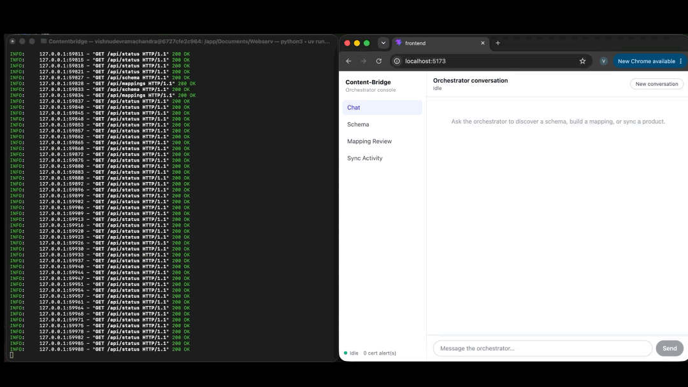

# Content-Bridge

Two CMSs, one company, and nobody wants to migrate. Content-Bridge connects WordPress and Strapi without moving anything off either one. Agents read each platform's live schema, work out how the fields correspond, write that down as an ontology, and then use it to push content from one side to the other.



## Why I built this

This is a solo project from a five-week agentic AI course run by Applied AI Institute and Arkadia Heilbronn. TUM Venture Labs gave some startup-style feedback along the way, which is why there's also a pitch deck in here.

The itch: LLM-assisted field mapping already exists for CMS *migrations*, where you map once and shut the old system down. I couldn't find much for the case where both systems have to stay alive because different teams own them. Marketing lives in WordPress, the product team lives in Strapi, and somebody ends up copy-pasting spec sheets between the two. That's the gap I wanted to poke at.

## The example it runs on

Everything is demoed against Sentinel Industrial Supply, a made-up B2B distributor of industrial (MRO) supplies. WordPress holds the blog posts and product pages. Strapi holds the structured catalog: products, certifications and standards. The seed data has six products. The goal is to take a product from Strapi and end up with a proper post in WordPress, without hand-writing the field mapping.

## How it works

There are four agents, built with pydantic-ai, all running on the same model through OpenRouter.

**Discovery** looks at the live API of both platforms and writes what it finds to `schema-ontology.ttl`. It can also search the web (Tavily) when a field is unclear.

**Mapping** reads that file, pulls real records from both sides to see what the fields actually contain, and proposes how they line up. The result goes into `mapping-ontology.ttl` in SSSOM format.

**Sync** takes a Strapi record, applies the mapping, and creates or updates the matching WordPress post. Every write is appended to `data/sync-log.jsonl`.

**Orchestrator** is the one you chat with. It runs the other three, passes their questions back to you, and feeds the frontend.

The rule I tried to design around: something only deserves an agent if the evidence leaves more than one defensible answer *and* those answers lead to different actions. If a regex or a declared schema settles it, it's just code. I haven't built that split yet. Right now every step goes through the LLM, and the tools the agents call only do I/O: fetching schemas and records, reading and writing files, calling the WordPress and Strapi APIs. Pulling the easy cases out into plain code is the obvious next step.

## Running it

You'll need Docker, Python 3.14 with [uv](https://docs.astral.sh/uv/), Node for the frontend, an [OpenRouter](https://openrouter.ai) key and a [Tavily](https://tavily.com) key.

```bash
git clone https://github.com/vishnudevramachandra/Content-Bridge.git
cd Content-Bridge
cp .env.example .env
```

Open `.env` and fill it in. Most of it is passwords and ports you can pick freely. The parts that need real values:

- `OPENAI_API_BASE` / `OPENAI_API_KEY`: the OpenRouter endpoint and your key (yes, the variable names say OpenAI, it's just the client I'm using)
- `MODEL`: defaults to `openai/gpt-5.1-codex-mini`
- `SEARCH_API_KEY`: your Tavily key
- The `STRAPI_*` secrets (app keys, salts, JWT secrets, encryption key): Strapi refuses to start without them. Generate each one with:
  ```bash
  node -e "console.log(require('crypto').randomBytes(16).toString('base64'))"
  ```
  `STRAPI_APP_KEYS` wants two to four of these, comma-separated.

Then start the CMSs:

```bash
docker compose up -d
docker compose ps
```

Give it 30 to 60 seconds. WordPress (8080), Strapi (1337) and Adminer (8081) should come up, and the two seed containers should show `exited (0)` once they've loaded the sample content.

One manual step: the Sync agent writes to WordPress using an application password, and I haven't automated creating it yet. Generate one and paste it into `.env` as `WP_ADMIN_APP_PASSWORD`:

```bash
docker compose exec wordpress wp --allow-root user application-password create admin contentbridge-sync-agent --porcelain
```

(Swap `admin` for whatever you set `WP_ADMIN_USER` to.)

Now the backend and frontend, in two terminals:

```bash
uv sync
uv run contentbridge          # API on :8000
```

```bash
cd frontend
npm install
npm run dev                   # console on :5173
```

### Trying it

Open http://localhost:5173 and use the Chat tab. Something like:

1. "Run discovery on both WordPress and Strapi and write schema-ontology.ttl"
2. "Build the mapping between the two schemas and write mapping-ontology.ttl"
3. "Sync a Strapi product to WordPress using the mapping" (if you're not sure which ID to use, ask it to list the products first)

The other tabs show what came out: the Schema tab draws the discovered classes, Mapping Review shows the proposed field mappings, and Sync Activity reads the sync log.

You can also talk to each agent straight from a terminal, e.g. `python -m contentbridge.agents.mapping.mapping_agent`. Same pattern for `discovery`, `sync` and `orchestrator`.

A full demo run should cost a few cents in OpenRouter credits, plus whatever Tavily charges. I haven't measured it carefully, and it grows the more back-and-forth you have with the agents.

## What's in the repo

```
src/contentbridge/   FastAPI backend, the four agents, WP/Strapi clients, ontology parsing
frontend/            React + Vite console (Chat, Schema, Mapping, Sync Log)
wordpress/           Docker image, a small custom plugin, seed scripts and content
strapi/              Strapi v5 project with product, certification and standard types
presentation/        Slidev pitch deck and demo recordings
sandbox/             where agents write their ontology files (gitignored)
data/                sync-log.jsonl
```

## Limitations

Being straight about what isn't finished:

- Sync only goes Strapi → WordPress. There's no reverse direction yet.
- There's no schema-drift detection. The "automation" part is currently just the orchestrator running the other agents.
- No tests, no CI.
- The backend keeps one global conversation, so it's strictly single-user.
- No retry or backoff when a call fails transiently.
- Ontology namespaces are hardcoded to `example.com` placeholders.
- The seed scripts assume the Sentinel Industrial Supply content, so pointing this at your own sites means doing real work.
- Strapi runs on SQLite only; I haven't tried anything else.
- The frontend expects the backend on port 8000, hardcoded in the Vite proxy.
- Needs Python 3.14, which uv can fetch for you but may surprise people.

## License

MIT, see [LICENSE](LICENSE).